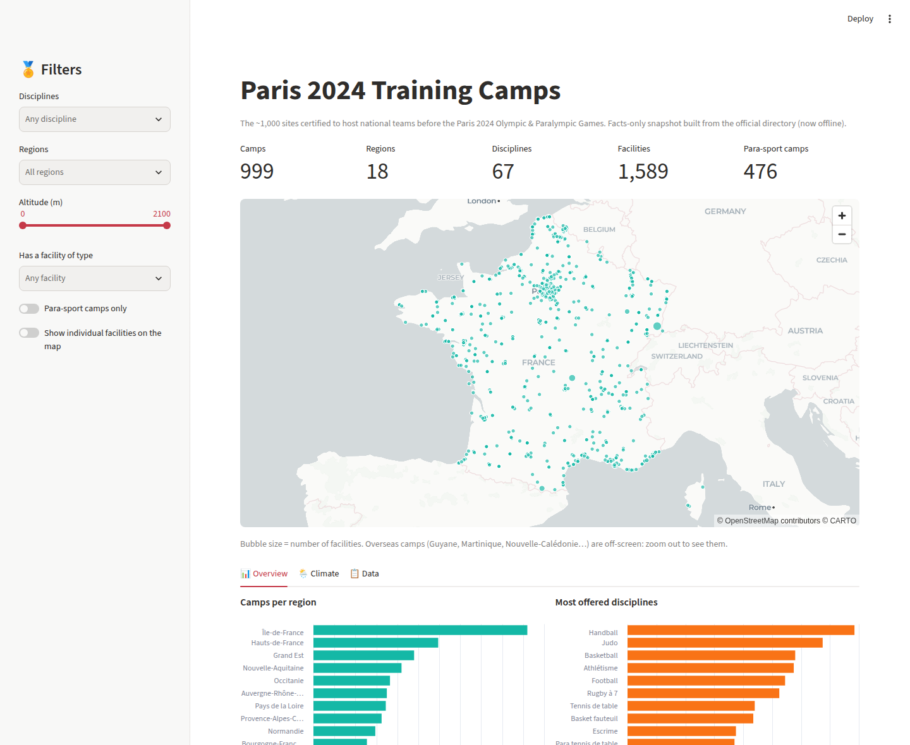
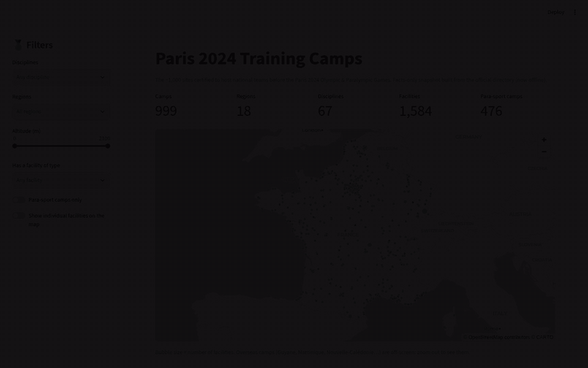
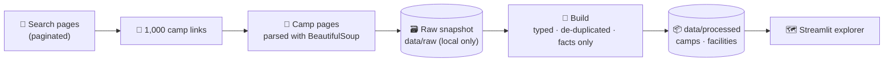

<div align="center">


# Paris 2024 Training Camps

### 999 Olympic & Paralympic training camps, scraped, cleaned and mapped.

Before the Paris 2024 Games, about 1,000 French venues were certified to host national teams.<br/>
Their official directory went offline after the Games. This project preserves it as a **clean, facts-only dataset**<br/>
and an **interactive map explorer**, built on a tested scraping pipeline.

<br/>

[](https://paris2024-training-camps.streamlit.app/)
&nbsp;
[](https://github.com/MedAmine-SUDO/paris2024-training-camps/actions/workflows/tests.yml)
&nbsp;
[](LICENSE)


<br/>



<br/><br/>



<sub>Filter by discipline and para-sport, then browse the charts and each camp's climate profile.</sub>

</div>

<br/>

## ✨ What's inside

<table>
<tr>
<td width="50%" valign="top">

### 🗺️ Interactive explorer
Filter camps by **discipline, region, altitude, facility type** or **para-sport**, and see them on a map sized by facility count. Toggle the 1,584 individual facilities, compare regions and disciplines, and download your selection as CSV.

### 🌦️ Climate profiles
Pick any camp to see its **monthly temperatures and rainfall**: handy for spotting altitude and warm-weather training sites.

</td>
<td width="50%" valign="top">

### 📦 A clean dataset
`data/processed/` holds **999 camps** and **1,584 facilities** as CSV and JSON: names, locations, GPS, altitude, 67 disciplines, options and climate normals. It's typed and de-duplicated, with regions normalized.

### 🕷️ A tested scraper
The async pipeline that crawled the directory: 1,000 links from paginated search, then parsing each camp page. It has retries, bounded concurrency and rate limiting, and is tested against HTML fixtures.

</td>
</tr>
</table>

<br/>

## ⚙️ How it works



1. **Scrape** (`camps-scrape`). Walk the search results, collect each camp link, and parse every page: title, address, map coordinates, facility counts, the facility slider, titled sections, and the climate and marker data embedded as JavaScript variables. Those are read with `json.loads`, never `eval`.
2. **Build** (`camps-build`). Validate each record with pydantic, then:
   - normalize regions and facility types
   - fill in the 17 regions the source left blank from an explicit city table
   - treat twelve-zero climate series as missing
   - drop duplicate listings

   Then write CSV and JSON.
3. **Explore** (`streamlit run app/explorer.py`). Everything runs from the processed files, so the explorer works even though the source site is gone.

<br/>

## 🏁 Get started

**No install needed:** open the live explorer at **[paris2024-training-camps.streamlit.app](https://paris2024-training-camps.streamlit.app/)**.

> 💤 Free Streamlit apps sleep when nobody has visited for a while. If you see a "wake up" button, click it and give it about 30 seconds.

To run it locally:

```bash
git clone https://github.com/MedAmine-SUDO/paris2024-training-camps.git
cd paris2024-training-camps
uv sync --extra app
uv run streamlit run app/explorer.py     # http://localhost:8501
```

Or use the data directly:

```python
import pandas as pd

camps = pd.read_csv("data/processed/camps.csv")
camps[camps.disciplines.str.contains("Judo")].groupby("region").size().sort_values()
```

<details>
<summary><b>☁️ Deploy your own copy on Streamlit Community Cloud (free)</b></summary>
<br/>

1. Fork this repository, then sign in at [share.streamlit.io](https://share.streamlit.io) with GitHub.
2. **Create app** → pick your fork, branch `main`, main file `app/explorer.py`, Python 3.12.
3. Deploy. Dependencies come from `requirements.txt`.

</details>

<br/>

## 📦 The dataset

| File | Rows | What's in it |
| --- | --- | --- |
| `camps.csv` | 999 | One row per camp: name, host organisation, city, region, altitude, GPS, disciplines, options, facility count, January min / July max temperature, annual rainfall |
| `camps.json` | 999 | The same camps, nested: discipline lists, facility counts by type, and full monthly climate series |
| `facilities.csv` | 1,584 | One row per facility: camp, name, type and GPS |

<details>
<summary><b>Column reference (camps.csv)</b></summary>
<br/>

| Column | Description |
| --- | --- |
| `camp_id` | Stable slug from the camp's original URL |
| `name`, `host` | Camp name and the local authority or club hosting it |
| `city`, `region` | Location. `region_inferred` is `true` for the 17 regions filled in from the city table |
| `altitude_m`, `lat`, `lon` | Altitude in metres and coordinates |
| `disciplines`, `para_disciplines` | ` \| `-separated lists |
| `options` | Extras such as sauna or weight room |
| `n_facilities`, `n_disciplines` | Counts |
| `temp_min_jan_c`, `temp_max_jul_c`, `annual_rainfall_mm` | Climate summaries (missing when the source had none) |

</details>

<br/>

## 🔒 Data ethics

| | |
| --- | --- |
| 📋 **Facts only** | The dataset keeps verifiable facts: names, places, coordinates, counts, disciplines and climate normals. The directory's descriptions and photos belong to their authors and are **not** redistributed. |
| 📵 **No contact details** | The raw pages contained venue emails and phone numbers. The build step drops every free-text field and **refuses to write output** if anything shaped like an email or phone number remains. A test checks the committed files too. |
| 🗃️ **Raw data stays local** | `data/raw/` is git-ignored. Only the processed, facts-only files are published. |
| 🤝 **Polite scraping** | Bounded concurrency, a delay between requests, retries with backoff, and an identifying user agent. |

> ℹ️ This is an independent portfolio project. It isn't affiliated with or endorsed by Paris 2024, the IOC or the IPC. The source directory was publicly accessible at `prepare.paris2024.org` until it went offline after the Games.

<br/>

## 🧪 Tests

```bash
uv run pytest
```

- ✅ **Parsing**, against synthetic HTML fixtures that mirror the original pages, since the site is offline
- ✅ **Building:** de-duplication, typing, region and facility normalization, missing-climate handling
- ✅ **The contact guard:** catches emails and phone numbers, ignores long coordinate decimals
- ✅ **The committed dataset:** 999 unique camps, every facility linked to a camp, no contact details

<br/>

## 🧰 Tech stack

| Layer | Technology |
| --- | --- |
| Scraping | httpx (async) · BeautifulSoup 4 |
| Modeling & cleaning | pydantic 2 · pandas |
| Explorer | Streamlit · pydeck (maps) · Altair (charts) |
| Tooling | uv · pytest · GitHub Actions |

<details>
<summary><b>Project structure</b></summary>
<br/>

```
├── src/camps/
│   ├── parse.py        # One camp page / search page -> raw record
│   ├── scrape.py       # Async crawl: search pages -> links -> parsed camps
│   └── build.py        # Raw records -> typed, facts-only dataset (+ contact guard)
├── app/explorer.py     # Streamlit map explorer
├── data/processed/     # camps.csv · camps.json · facilities.csv (committed)
├── data/raw/           # original scrape (git-ignored)
├── tests/              # parser, build and dataset tests + HTML fixtures
└── .github/workflows/tests.yml
```

</details>

<details>
<summary><b>From a quick script to this</b></summary>
<br/>

The first version was a one-off Selenium script. It worked, but it opened a new Chrome window per page with fixed 5-second waits, ran `eval()` on JavaScript from the site, appended to its output file on every run, and wrote nested data into the CSV as Python text. This rebuild:

- **Fetching:** shared HTTP connections with bounded concurrency, instead of a browser per page.
- **Safer parsing:** the JavaScript data is read with `json.loads` instead of `eval()`.
- **Clean output:** one validated JSON snapshot, plus properly flattened CSV files.
- **A real cleaning step:** regions, facility types, duplicates and missing climate data.
- **Tests and CI**, and an explorer that turns the data into something you can use.

</details>

<br/>

## 🗺️ Roadmap

- [x] Deploy the explorer on Streamlit Community Cloud
- [ ] Distance search: "camps within 50 km of…"
- [ ] Enrich with transport access (nearest train station, airport)
- [ ] Publish the dataset on Kaggle / data.gouv.fr

<br/>

<div align="center">

Made with ☕ by [**MedAmine-SUDO**](https://github.com/MedAmine-SUDO)

If you find the dataset useful, consider giving it a ⭐

</div>
